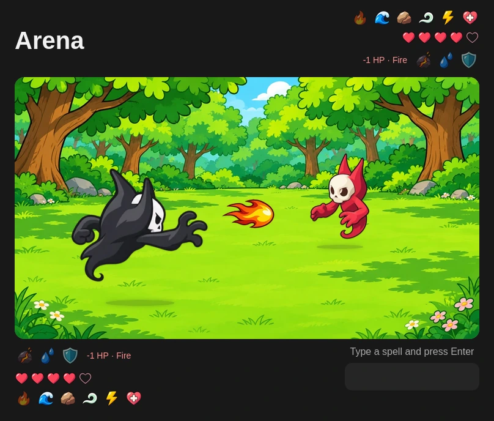

# Typing Fighter

A turn-based magic duel against the computer. Cast spells by typing their names.

## Getting Started

1. Open [Typing Fighter](https://salman-tdls.github.io/typing-fighter/). Type `start` and press Enter.
2. Both fighters start at 5 HP. Type a spell and press Enter. The computer replies if it still has HP.
3. Each fighter can use each spell once per duel.

The first fighter to reach 0 HP loses. If both fighters run out of spells, higher HP wins. Equal HP is a draw. Click **Restart** to play again.

[Project board](https://github.com/users/Salman-TDLS/projects/3) · [Original wireframe](https://github.com/user-attachments/assets/fb504541-29f6-4312-b522-3efca2112f6a)

## Spells

`fire`, `water`, `rock`, `air`, `electric`, and `cure`.

Hover over a spell icon to see its name. Open **How to play** on the start menu for spell effects and combos.

## Credits

The forest, fighter sprites, and spell effects were made with ImageGen. \
The fighters are based on the CC0 model Ghost Skull by [Quaternius](https://poly.pizza/u/Quaternius).

## Technologies Used

- HTML
- CSS with Flexbox
- JavaScript with DOM manipulation and the Web Animations API
- GitHub Pages for hosting

## Next Steps

- Add sound effects.
- Add more fighting stages.
- Add more enemies.
